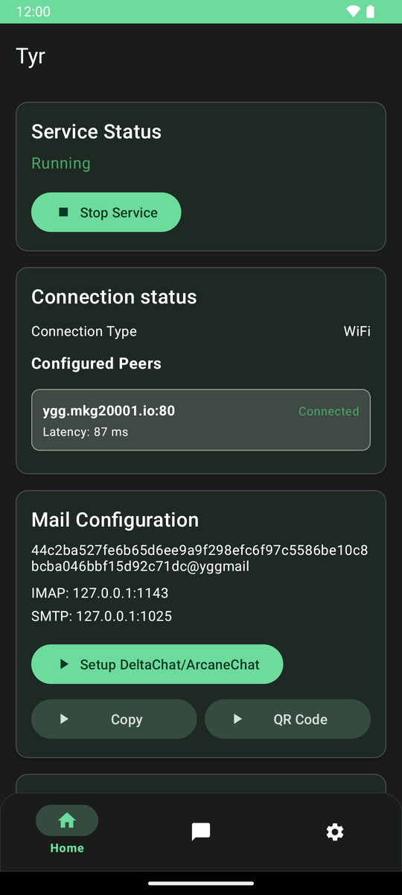
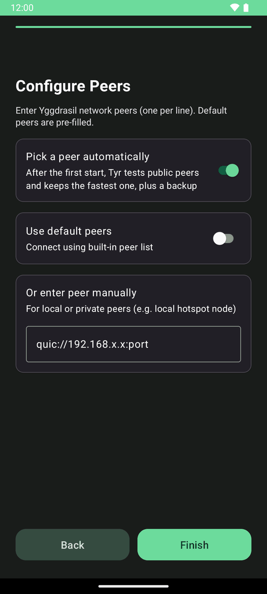
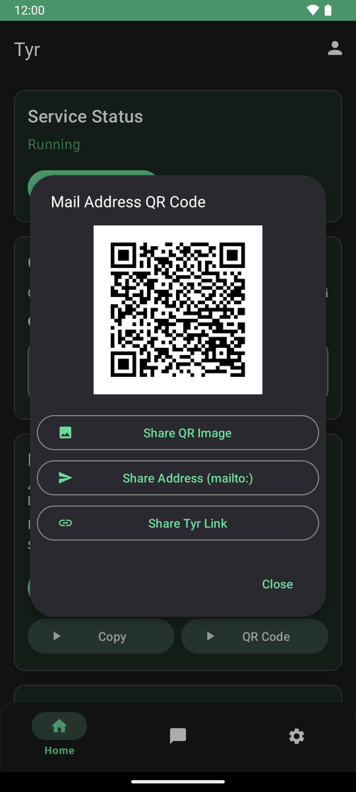
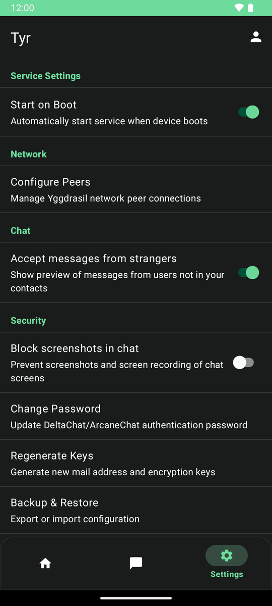

<div align="center">


# Tyr

A mail server that runs on your phone and delivers straight to other phones<br>
over the [Yggdrasil](https://yggdrasil-network.github.io/) mesh. No provider in between.

[](https://apt.izzysoft.de/packages/com.jbselfcompany.tyr)

[](https://apt.izzysoft.de/packages/com.jbselfcompany.tyr)

<sub>Android 6.0 or newer</sub>

<br>

&nbsp;
&nbsp;
&nbsp;


</div>

## What it is

Tyr embeds [yggmail-ng](https://github.com/JB-SelfCompany/Yggmail-ng) and runs it as a
foreground service. Your address is your public key, `<64 hex>@yggmail`, so nobody can
register it before you or impersonate it. Mail travels node to node across Yggdrasil,
which encrypts it in transit, with no MX records, port forwarding or relay to trust.

On the phone it looks like an ordinary mail account on `127.0.0.1`, so DeltaChat,
ArcaneChat, K-9 Mail, FairEmail or Thunderbird can use it as-is. Tyr also has a small
chat of its own for text and photos.

- Peers picked for you: Tyr tests public peers, connects to the fastest and keeps a
  second one on standby that takes over if the first one drops
- One-tap setup for DeltaChat and ArcaneChat; plain SMTP/IMAP for everything else
- Address sharing by QR code, `mailto:` or link
- Mail and the private key are encrypted at rest; the password is encrypted with a key
  held in the Android Keystore
- Password-encrypted backups that can carry the mail archive and chats
- Starts on boot, Doze-aware, notifies without Google or any push service

## Install

Get it from [IzzyOnDroid](https://apt.izzysoft.de/packages/com.jbselfcompany.tyr) or
download an APK from [Releases](https://github.com/JB-SelfCompany/Tyr/releases). Releases
come per ABI (`arm64-v8a` fits almost every current phone) and as a larger `universal` build.

Release APKs are signed with this certificate:

```
Package   com.jbselfcompany.tyr
SHA-256   5B:AE:87:76:77:27:DE:3D:39:60:01:25:F6:26:3E:51:5A:69:87:F1:FA:A9:72:52:75:98:A9:B1:FD:A4:F6:9E
```

Check a download with `apksigner verify --print-certs Tyr-*.apk`.

## Getting started

1. Open Tyr, set a password, and leave **Pick a peer automatically** on.
2. Wait for the peer to show **Connected** on the home screen. The first pick takes about a minute.
3. Tap **Setup DeltaChat/ArcaneChat**. The app opens with the account already filled in.

For any other mail client, add an account by hand:

| Field    | Value                                   |
|----------|-----------------------------------------|
| Address  | your `<64 hex>@yggmail` from the home screen |
| Password | the one you set in Tyr                  |
| IMAP     | `127.0.0.1`, port `1143`, no TLS        |
| SMTP     | `127.0.0.1`, port `1025`, no TLS        |

> [!IMPORTANT]
> Mail only moves while Tyr is running. Keep **Start on Boot** on and allow the app to
> ignore battery optimization when asked.

## How it works

```
 DeltaChat · K-9 · Tyr chat
        │  SMTP :1025 / IMAP :1143, loopback only
        ▼
 Tyr ─ yggmail-ng (Rust, via UniFFI) ──▶ Yggdrasil mesh ──▶ recipient's Tyr
```

The server is written in Rust and shipped as `libyggmail_mobile.so`. Tyr starts it,
keeps it alive, watches the peer link and swaps to the backup peer after two minutes
of downtime.

Some things to know before relying on it:

- Both sides need to be online for a message to cross. Outgoing mail waits in a queue
  and is retried, but there is no server holding mail for you while your phone is off.
- `<64 hex>@yggmail` addresses only reach other Yggmail nodes, not regular email.
- The localhost SMTP and IMAP ports have no TLS. They are bound to `127.0.0.1` and need
  the password, but any app on the device can try to connect.
- Regenerating keys gives you a new address. Make a backup first if you want to keep the old one.

## Building

<details>
<summary>JDK 17 and the Android SDK are all you need for the app itself.</summary>

<br>

```bash
git clone https://github.com/JB-SelfCompany/Tyr.git
cd Tyr
./gradlew assembleDebug        # app/build/outputs/apk/debug/
./gradlew testDebugUnitTest    # unit tests (JUnit + Robolectric)
```

Set the SDK path in `local.properties` (`sdk.dir=...`) or `ANDROID_HOME`. A release
build without `keystore.properties` comes out unsigned, which is what F-Droid style
reproducible builds expect.

The native library is prebuilt in `app/src/main/jniLibs/<abi>/`, with its UniFFI bindings
in `app/src/main/java/uniffi/`. `native-sources.txt` records the exact yggmail-ng commit and
toolchain. Rebuilding it needs Rust with the `aarch64`, `armv7`, `x86_64` and `i686`
Android targets, `cargo-ndk` and the NDK;
the steps are in the [yggmail-ng README](https://github.com/JB-SelfCompany/Yggmail-ng#android-library).

</details>

## Related

[yggmail-ng](https://github.com/JB-SelfCompany/Yggmail-ng), the server inside Tyr ·
[Yggdrasil](https://yggdrasil-network.github.io/) ·
[DeltaChat](https://delta.chat/) ·
[ArcaneChat](https://github.com/ArcaneChat/android) ·
[Mimir](https://github.com/Revertron/Mimir), a P2P messenger on Yggdrasil

## License

GPLv3, see [LICENSE](LICENSE). The bundled yggmail-ng library is MPL-2.0.
